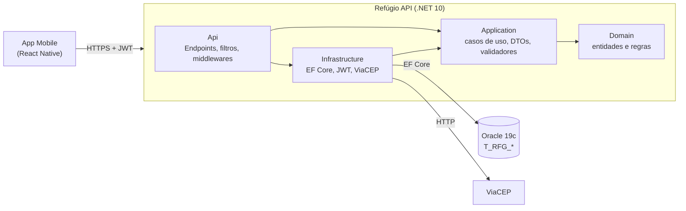

# Refúgio API

Backend em .NET 10 do **Refúgio**, solução CitizenTech da Global Solution 2026/2 (FIAP).

## O problema

Ondas de calor são perigosas para idosos: insolação e desidratação chegam rápido, e muitos moram em casas sem ventilação adequada. As cidades já têm lugares frescos e públicos (bibliotecas, CEUs, UBSs, centros comunitários) que podem funcionar como **refúgios climáticos**, mas o idoso não sabe onde fica o mais próximo nem se ainda há vaga.

O Refúgio resolve isso: o **idoso** encontra um refúgio aberto no bairro, reserva uma vaga e mostra o comprovante na porta; o **gestor** cadastra e mantém os refúgios. Esta API é a mesma consumida pelo app Mobile.

**ODS atendidos:** 3 (Saúde e bem-estar), 11 (Cidades e comunidades sustentáveis) e 13 (Ação contra a mudança global do clima).

## Requisitos da disciplina e onde estão

| Requisito (Advanced Business Development with .NET) | Onde |
|---|---|
| Minimal API RESTful, validações e códigos HTTP | `src/Refugio.Api/Endpoints`, validadores em `src/Refugio.Application/Validators`, erros em `Middlewares/TratamentoDeErrosMiddleware.cs` |
| OpenAPI + Swagger | `/swagger` e `/openapi/v1.json`, com esquema Bearer e respostas 400/401/403/404/409/422/429 documentadas |
| Requisições repetidas (idempotência) | Header `Idempotency-Key` no `POST /api/v1/reservas` (`UseCases/Reservas`) |
| Rate limiting com 429 | `Extensions/RateLimitExtensions.cs`: limite global, de `/auth` e de reservas, com `Retry-After` |
| JWT, controle de acesso e HealthChecks | `Infrastructure/Auth` (papéis IDOSO e GESTOR) e `/health` (API, banco e ViaCEP) |
| Testes unitários e de integração com xUnit | `tests/Refugio.UnitTests` (regras de negócio) e `tests/Refugio.IntegrationTests` (endpoints contra o Oracle) |

## Arquitetura



| Camada | Responsabilidade |
|---|---|
| `Refugio.Domain` | Entidades `Refugio`, `Reserva` e `Usuario` e as regras de negócio (vagas, refúgio inativo, uma reserva por dia, cancelamento). Não depende de nada. |
| `Refugio.Application` | Casos de uso (`CriarReserva`, `ListarRefugios`...), DTOs no formato do contrato, validadores FluentValidation e as interfaces que a infraestrutura implementa. |
| `Refugio.Infrastructure` | EF Core com Oracle, repositórios, JWT e hash de senha, cliente do ViaCEP e health checks. |
| `Refugio.Api` | Minimal APIs, tratamento de erros em ProblemDetails, rate limiting, OpenAPI e composição em `Program.cs`. |

### Banco de dados

Oracle 19c da FIAP. O schema é compartilhado com outros trabalhos, então as tabelas do Refúgio têm prefixo próprio:

| Tabela | Conteúdo |
|---|---|
| `T_RFG_USUARIO` | Idosos e gestores, com senha em hash (PBKDF2), bairro, telefone e contato de emergência |
| `T_RFG_REFUGIO` | Refúgios: tipo, CEP, endereço, bairro, capacidade, horário, acessibilidade e se está ativo |
| `T_RFG_RESERVA` | Reserva de um idoso em um refúgio para uma data, com status e a `Idempotency-Key` |
| `T_RFG_EF_MIGRACOES` | Histórico das migrações do EF Core |

O DDL está em [scripts/script-bd.sql](scripts/script-bd.sql). A API aplica as migrações ao iniciar.

## Como rodar

**Pré-requisitos:** .NET SDK 10 e acesso ao Oracle (usuário e senha da FIAP).

### Com `dotnet run` (desenvolvimento)

As credenciais ficam nos user-secrets, fora do repositório:

```bash
dotnet user-secrets set "ConnectionStrings:Refugio" "User Id=SEU_RM;Password=SUA_SENHA;Data Source=oracle.fiap.com.br:1521/ORCL" --project src/Refugio.Api
dotnet user-secrets set "Jwt:Chave" "$(openssl rand -base64 48)" --project src/Refugio.Api

dotnet run --project src/Refugio.Api
```

Swagger em http://localhost:5159/swagger. Na primeira execução, a API cria as tabelas `T_RFG_*` e grava os dados de exemplo.

### Com Docker

```bash
cp .env.example .env     # preencha ORACLE_USUARIO, ORACLE_SENHA e JWT_CHAVE
docker compose up -d --build
```

Swagger em http://localhost:8080/swagger. O Dockerfile fica em [dockerfiles/Dockerfile](dockerfiles/Dockerfile).

### Testes

```bash
dotnet test
```

Os testes de integração sobem a API real contra o Oracle configurado nos user-secrets (ou na variável `ConnectionStrings__Refugio`, no CI). Eles usam tabelas próprias com prefixo `T_RFGTST_`, criadas no início e apagadas no fim, sem tocar nas tabelas do app. O ViaCEP é substituído por um dublê.

## Usuários de teste

Criados pelo seed na primeira execução. A senha vem de `Seed:SenhaUsuarios` (padrão `Senha@123`).

| E-mail | Papel |
|---|---|
| `gestor@refugio.com` | GESTOR |
| `maria@email.com` | IDOSO (com bairro e contato de emergência preenchidos) |
| `jose@email.com` | IDOSO |

O cadastro pela API (`/auth/registrar`) cria sempre IDOSO. Contas de gestor só vêm do seed.

## Endpoints

| Método e rota | Quem | O que faz |
|---|---|---|
| `POST /auth/registrar` | Público | Cria conta de idoso → 201 |
| `POST /auth/login` | Público | Devolve `token`, `expiraEm` e `usuario` |
| `GET /api/v1/refugios?bairro=&data=&pagina=&tamanho=` | Logado | Lista paginada com vagas da data |
| `GET /api/v1/refugios/{id}?data=` | Logado | Detalhe com vagas da data |
| `POST /api/v1/refugios` | GESTOR | Cria → 201 com `Location` |
| `PUT /api/v1/refugios/{id}` | GESTOR | Atualiza → 200 |
| `DELETE /api/v1/refugios/{id}` | GESTOR | Exclui → 204; 409 se houver reservas ativas futuras |
| `GET /api/v1/cep/{cep}` | GESTOR | Endereço pelo ViaCEP → 200, 404 ou 400 |
| `POST /api/v1/reservas` | IDOSO | Reserva (exige `Idempotency-Key`) → 201 |
| `GET /api/v1/reservas/minhas` | IDOSO | Reservas ativas de hoje em diante, da mais próxima à mais distante |
| `GET /api/v1/reservas/{id}` | IDOSO | Comprovante; 403 se for de outro idoso |
| `DELETE /api/v1/reservas/{id}` | IDOSO | Cancela → 204 |
| `GET /api/v1/usuarios/me` | Logado | Perfil |
| `PUT /api/v1/usuarios/me` | Logado | Atualiza nome, bairro, telefone e contato de emergência |
| `GET /health` · `GET /health/live` | Público | Saúde da API, do banco e do ViaCEP · só o processo |

O roteiro completo com os corpos JSON está em [src/Refugio.Api/Refugio.Api.http](src/Refugio.Api/Refugio.Api.http).

### Exemplos do contrato

`POST /auth/login` → 200

```json
{
  "token": "eyJhbGciOi...",
  "expiraEm": "2026-11-15T15:30:00-03:00",
  "usuario": { "id": 2, "nome": "Maria Souza", "email": "maria@email.com", "papel": "IDOSO" }
}
```

`POST /api/v1/reservas` com `Idempotency-Key: 6f1c2a9e-...` → 201

```json
// requisição
{ "refugioId": 1, "dataReserva": "2026-11-15" }

// resposta
{
  "id": 41,
  "refugioId": 1,
  "refugioNome": "Biblioteca Municipal da Penha",
  "refugioEndereco": "Rua Exemplo, 100 — Penha",
  "dataReserva": "2026-11-15",
  "status": "ATIVA",
  "criadoEm": "2026-11-14T10:02:11-03:00"
}
```

Erro (sempre ProblemDetails):

```json
{ "title": "Sem vaga", "status": 409, "detail": "Este refúgio não tem mais vagas para 15/11." }
```

Formatos: datas `yyyy-MM-dd`, horários `HH:mm`, data e hora em ISO 8601 no fuso de São Paulo, enums em maiúsculas (`BIBLIOTECA`, `CENTRO_COMUNITARIO`, `ATIVA`).

### Códigos de status

| Status | Quando |
|---|---|
| 200 / 201 / 204 | Sucesso |
| 400 | Validação, com o erro em `errors.<campo>` |
| 401 | Login inválido, token ausente, inválido ou expirado |
| 403 | Papel sem permissão, ou reserva de outro idoso |
| 404 | Refúgio, reserva ou CEP inexistente |
| 409 | Sem vaga, já tem reserva no dia, e-mail já cadastrado, refúgio com reservas na exclusão |
| 422 | Refúgio inativo, `Idempotency-Key` reutilizada com outro corpo, cancelamento de reserva passada |
| 429 | Limite de requisições; o header `Retry-After` diz em quantos segundos tentar |
| 503 | ViaCEP fora do ar |

## Decisões de projeto

- **Idempotência:** a chave enviada pelo app fica na própria reserva, com índice único por idoso. Repetir a mesma chave com o mesmo corpo devolve a reserva original (com o header `Idempotent-Replayed: true`); com outro refúgio ou data, devolve 422.
- **Concorrência:** criar uma reserva bloqueia a linha do idoso e a do refúgio (`SELECT ... FOR UPDATE`), sempre nessa ordem para não haver deadlock. Assim, dois pedidos simultâneos não passam da capacidade nem criam duas reservas do mesmo idoso no mesmo dia. Os testes de integração cobrem os dois casos.
- **Excluir refúgio** com reservas ativas de hoje em diante devolve 409: o gestor deve desativar (`ativo: false`) em vez de excluir.
- **Fuso horário:** "hoje" e `criadoEm` usam o fuso de São Paulo, como combinado com o app.
- **Rate limit:** login e cadastro contam por IP (contra força bruta); o resto conta por usuário do token. Limites em `appsettings.json` (`RateLimit`).
- **Segredos:** connection string e chave JWT nunca ficam no repositório (user-secrets, `.env` ou variáveis de ambiente).

## Bibliotecas

| Biblioteca | Por quê |
|---|---|
| `Oracle.EntityFrameworkCore` | EF Core com o Oracle da FIAP (exigência: EF Core ou Dapper) |
| `Microsoft.AspNetCore.Authentication.JwtBearer` | Validação do JWT |
| `Microsoft.AspNetCore.OpenApi` + `Swashbuckle.AspNetCore.SwaggerUI` | Documento OpenAPI nativo do .NET e a interface do Swagger |
| `FluentValidation` | Validação dos DTOs com mensagens por campo |
| `Microsoft.Extensions.Diagnostics.HealthChecks.EntityFrameworkCore` | Health check do banco |
| `xunit`, `Microsoft.AspNetCore.Mvc.Testing` | Testes unitários e de integração |

## Fluxo de Git

- `main` recebe só versões fechadas, com tag: `v0.1.0` (estrutura), `v0.2.0` (base), `v0.3.0` (funcionalidades), `v0.4.0` (proteção), `v1.0.0` (entrega).
- `develop` integra as atividades. Cada atividade é uma branch `feature/AT-XX-...` com merge `--no-ff`.
- Commits no padrão `tipo(escopo): descrição [AT-XX]`, por exemplo `feat(reserva): ... [AT-07]`.

## Integrantes

| Nome | RM |
|---|---|
| _preencher_ | _preencher_ |

## Declaração de uso de IA

Este backend foi desenvolvido com apoio do **Claude Code (Anthropic)**, usado para gerar código, testes e documentação a partir do plano do grupo e do contrato combinado com o time Mobile. Todo o código foi revisado e testado pelo grupo antes da entrega. _(O grupo deve completar: quem revisou o quê e quais partes foram alteradas manualmente.)_
